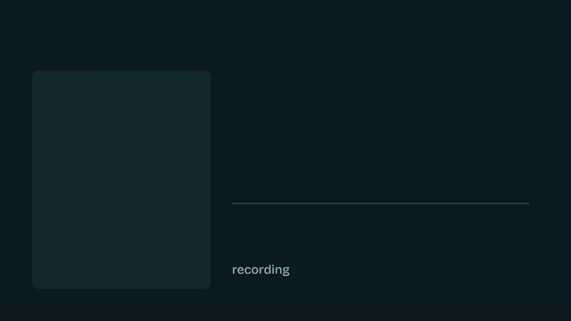
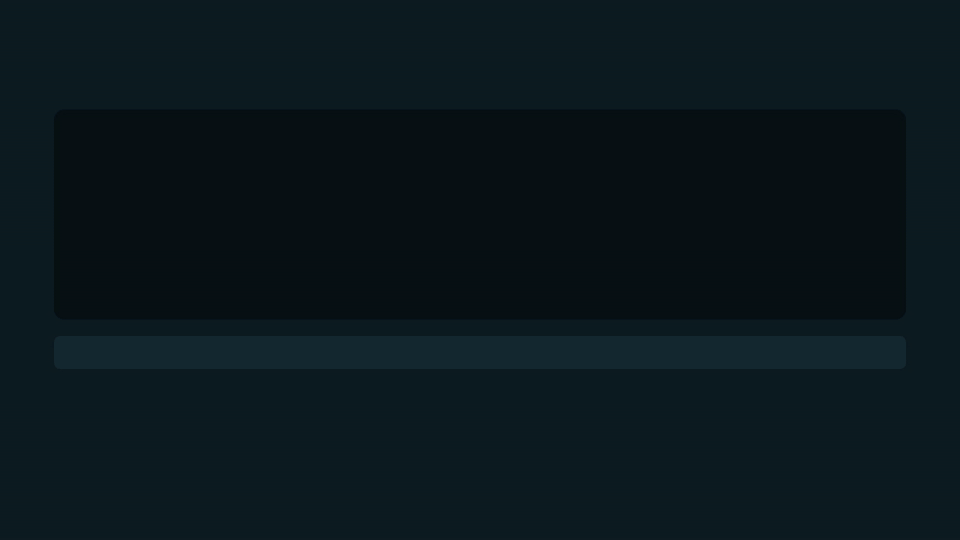

# GTA 6 Clip Creator

**Turns long GTA 6 streams and YouTube videos into captioned 9:16 Shorts and Reels.**

It watches Twitch and YouTube live streams, finds the moments when chat goes wild, cuts them out, and frames them for a phone. It can also make Shorts from a video that is already uploaded, with Hinglish captions for Hindi speech.


▶ **[Watch the 45-second tour](docs/media/tour.mp4)** (no sound)

## Contents

- [What it can do](#what-it-can-do)
- [How it works](#how-it-works)
- [Install](#install)
- [Use it](#use-it)
- [Choose the frame yourself](#choose-the-frame-yourself)
- [Settings](#settings)
- [Where the files go](#where-the-files-go)
- [Project structure](#project-structure)
- [Tests](#tests)
- [How the animations were made](#how-the-animations-were-made)

## What it can do

| You have | Run | You get |
|---|---|---|
| A channel that is live now, or will be | `run.bat` | A clip for every chat spike, plus a 9:16 reel |
| A finished YouTube stream, or a video file | `vod.bat` | The strongest moments, plus 9:16 reels |
| An uploaded YouTube video, or a video file | `shorts.bat` | Finished Shorts with a headline and captions |

- **No account or API key is needed** to watch streams, read chat, cut clips, transcribe or render.
- **Transcription runs on your computer** with [faster-whisper](https://github.com/SYSTRAN/faster-whisper), on an NVIDIA GPU or on the CPU.
- **Nothing is posted** to YouTube or Instagram. You get files, and you decide what to publish.
- **Claude is optional.** If you use it, what it needs to judge is sent to Anthropic: the transcript and, for a review, a few frames and some chat messages.

## How it works

### 1. Live chat finds the moment



The stream is recorded in 4-second segments while the chat is read. Every message gets a weight:

| Weight | Messages |
|---|---|
| **0** | Spam (`W W W`), greetings, giveaway begging, like counts, bots, "no sound" |
| **0.5** | Only channel emotes |
| **1** | Ordinary messages |
| **2** | Laughing and shock: `lmao`, `OMG`, `clip it`, `kya` |

A viewer who repeats a line within a minute, or posts again within 5 seconds, is not counted again. When the last 10 seconds stand out from the previous 5 minutes, the tool cuts **20 seconds before and 15 seconds after** that point.

For finished YouTube streams it reads the chat replay. If there is no replay, it looks for the loudest moments instead.

### 2. Every clip gets processed


1. **Transcribe:** speech to text, on your computer.
2. **Review (optional):** with `ANTHROPIC_API_KEY` set, Claude looks at the frames, the transcript and the chat. A clip is approved when it shows the right game, is worth posting, and scores at least 60.
3. **Render 9:16:** the webcam goes on top and the gameplay below.

Without an API key the review is skipped, and reels go to `unreviewed/` for you to judge.

### 3. Uploaded videos become Shorts



`shorts.bat` does the mechanical work and **stops when a decision is needed**. It then prints `NEEDS CLAUDE:` and the file it is waiting for. [Claude Code](https://claude.com/claude-code) reads the transcript, writes the file, and runs the command again. Hindi videos stop a second time, for the Hinglish captions. The included [`make-shorts` skill](.claude/skills/make-shorts/SKILL.md) contains those instructions.

There are two other ways to make the choices:

- Add `--auto`, and the tool chooses by "most replayed" or loudness.
- Set `ANTHROPIC_API_KEY`, and the Claude API chooses.

### 4. Faces decide the layout


| Video type | What it is | Layout |
|---|---|---|
| `gaming_facecam` | Gameplay with a webcam in the corner | **split:** webcam on top, gameplay below |
| `gameplay` | Gameplay or a screen, no face | **fit:** whole frame on a blurred background |
| `talking_head` | One person fills the frame | **crop:** 9:16 crop that follows the face |
| `group` | Several people, such as a podcast | **fit** |

### 5. Captions people can read


Hindi speech is written the way people type it: `भाई ये क्या हो गया` becomes `bhai ye kya ho gaya`. The spoken word is highlighted, and a headline stays at the top so viewers know what the Short is about.

## Install

You need:

- **Windows** for the `.bat` files
- **[Python](https://www.python.org/downloads/) 3.10 or newer** (tested with 3.11)
- **[FFmpeg](https://ffmpeg.org/download.html)**, with `ffmpeg` and `ffprobe` on your PATH
- An NVIDIA GPU is optional and makes transcription much faster

In PowerShell:

```powershell
git clone https://github.com/pasha1442/GTA-6.git
cd GTA-6
python -m venv "$env:USERPROFILE\.clipcreator\venv"
& "$env:USERPROFILE\.clipcreator\venv\Scripts\python.exe" -m pip install -r requirements.txt
```

For an NVIDIA GPU, also run:

```powershell
& "$env:USERPROFILE\.clipcreator\venv\Scripts\python.exe" -m pip install nvidia-cublas-cu12 nvidia-cudnn-cu12
```

The speech model and a small face model download the first time they are needed.

## Use it

### Watch live channels

```powershell
.\run.bat channelname "@youtubehandle"
```

A plain name is a Twitch channel and `@handle` is a YouTube channel. Links to either also work. You can list channels in `config.json` instead and just run `.\run.bat`. Press `Ctrl+C` to stop.

### Make clips from a finished stream

```powershell
.\vod.bat "https://www.youtube.com/watch?v=VIDEOID" --top 5
```

Add `--no-post` to get only the clips, with no transcript, review or reel.

### Make Shorts from an uploaded video

With Claude Code, open this folder and type:

```text
/make-shorts https://www.youtube.com/watch?v=VIDEOID --count 5
```

Without it, let the tool decide everything:

```powershell
.\shorts.bat "https://www.youtube.com/watch?v=VIDEOID" --auto
```

| Option | Meaning |
|---|---|
| `--count N` | How many Shorts (default 5) |
| `--min S` `--max S` | Length in seconds (default 20 to 60) |
| `--lang hi` or `--lang en` | Set the spoken language (default: detect) |
| `--layout L` | `auto`, `split`, `track`, `crop` or `fit` |
| `--only 1,3` | Render only these Shorts again |
| `--no-subs` | No captions |
| `--upper` | Captions in capitals |
| `--no-hook` | No headline at the top |
| `--force` | Ignore the saved plan and choose the moments again |
| `--auto` | Never stop for a decision |

### Process clips again

```powershell
.\process.bat clips\some-channel
```

Add `--force` to redo clips that were already processed.

## Choose the frame yourself

If the tool picked the wrong part of the screen, open the frame selector:

```powershell
.\frames.bat clips\shorts-VIDEOID
```

It opens a page that only your computer can reach. Choose a layout, drag the webcam and gameplay boxes, turn face tracking on or off, and check the phone preview. You can do this for every Short or just one. **Save & render** makes the Shorts again, and the tool never replaces a layout you saved.

## Settings

Edit [`config.json`](config.json). Anything you leave out uses the default in [`clipper/__main__.py`](clipper/__main__.py).

| Setting | In `config.json` | Meaning |
|---|---|---|
| `channels` | `[]` | Channels to watch |
| `quality` | `"best"` | Stream quality |
| `poll_seconds` | `60` | How often to check whether a channel is live |
| `clip_before_seconds` | `20` | Video kept before the spike |
| `clip_after_seconds` | `15` | Video kept after the spike |
| `spike.window` | `10` | Seconds of chat that count as "now" |
| `spike.factor` | `1.5` | Spike must be this many times the normal rate |
| `spike.zscore` | `2.5` | Spike must be this many standard deviations above normal |
| `spike.min_messages` | `6` | Smallest weighted message count that can be a spike |
| `spike.cooldown` | `60` | Seconds between two spikes |

All three spike limits must be passed. **Too many clips?** Raise `factor`; the built-in value is `3.0`. **Too few?** Lower `factor` or `min_messages`.

To use it for another game, set `game` and `game_notes`, which tell the reviewer what to accept.

## Where the files go

Your videos stay on your computer: `clips/` is not part of this repository.

```text
clips/
├── channelname/                     from run.bat and vod.bat
│   ├── channelname-<time>-x2.5.mp4  the clip; x2.5 = 2.5 times the normal rate
│   ├── channelname-<time>-x2.5.json transcript, review, chat sample
│   └── reels/
│       ├── approved/                passed the review
│       ├── rejected/                failed (empty unless render_rejected is on)
│       └── unreviewed/              no review was made
└── shorts-VIDEOID/                  from shorts.bat
    ├── source.mp4                   the downloaded video
    ├── transcript.txt
    ├── scene.jpg                    sampled frames with the faces marked
    ├── layout.json                  what each Short shows
    ├── plan.json                    the chosen moments
    ├── work/                        captions and temporary files
    ├── short-01-<title>.mp4         finished, 1080 × 1920
    └── short-01-<title>.json        title, caption, hashtags
```

Temporary recordings and models are kept in `%USERPROFILE%\.clipcreator`.

## Project structure

| Path | Job |
|---|---|
| `clipper/__main__.py` | Watches channels, records, cuts clips |
| `clipper/chat.py`, `youtube.py` | Read Twitch and YouTube chat |
| `clipper/chatscore.py`, `spikes.py` | Weigh messages, detect spikes |
| `clipper/recorder.py` | Records segments and cuts clips |
| `clipper/vod.py` | Finds moments in finished videos |
| `clipper/process.py`, `review.py` | Transcribe, review and render each clip |
| `clipper/shorts.py` | Makes Shorts from uploaded videos |
| `clipper/faces.py`, `layouts.py`, `vertical.py` | Find faces, choose and render the 9:16 frame |
| `clipper/transcribe.py`, `subtitles.py` | Speech to text, captions, Hinglish |
| `clipper/frames.py`, `frames.html` | The frame selector |
| `motion/` | Source of the animations on this page |
| `tests/` | Unit tests |

## Tests

```powershell
& "$env:USERPROFILE\.clipcreator\venv\Scripts\python.exe" -m unittest discover -s tests
```

## How the animations were made

They are [Remotion](https://www.remotion.dev) videos, drawn in code. They contain no game footage and no real people. To change them you need Node.js and FFmpeg:

```powershell
cd motion
npm install
npm run dev
```

`npm run dev` opens the editor, and `npm run render` writes every file in `docs/media`. Remotion has its own [license](https://www.remotion.dev/docs/license): it is free for individuals and small teams, and larger companies need a paid license.

## Good to know

- YouTube live chat is read from unofficial web endpoints, so it can stop working when YouTube changes them.
- Speech recognition makes mistakes, especially in Hindi. Check the captions before you post.
- Only use videos you own or have permission to use, and follow each platform's rules.
- This is a fan-made tool. It is not affiliated with or endorsed by Rockstar Games, Take-Two, Twitch or YouTube.

## License

[MIT](LICENSE)
